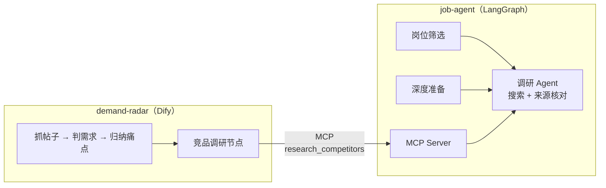

# 两颗种子：求职 Agent + 需求雷达

两个"有人愿意用"的 Agent 项目，共用一个内核。

| 项目 | 做什么 | 技术 | 在线 |
|---|---|---|---|
| [`job-agent/`](job-agent/README.md) | 求职：每天筛岗位（匹配分 + 风险标签 + 投递建议），拿到面试后深度准备（差距分析、公司调研、防编造的简历改写、面试题） | LangGraph + LangChain + FastAPI + React | https://job.wyphub.com |
| [`demand-radar/`](demand-radar/README.md) | 找需求：领域 → 抓 HN / GitHub / V2EX 近期讨论 + App Store 差评 → 痛点排序（原话核对）→ 竞品调研 | Dify 工作流（[画布截图](demand-radar/README.md#dify-里的样子)） | https://udify.app/workflow/yHnTLKMPzJuCRc2h （Dify 官方云，一次约 3 分钟） |
| `step0-react/` | 第 0 步：手写约 50 行的最小 ReAct 循环，理解 Agent 本质 | OpenAI SDK（调 DeepSeek），不用框架 | 学习用 |

## 一个内核，两个应用

求职 Agent 里写好的"调研 Agent"（ReAct 循环、搜索次数封顶、每条事实的链接必须是本次搜索返回过的），通过 MCP 协议开放出去；需求雷达在 Dify 里直接当工具调用。实测对比：Dify 里直接问模型要竞品，具体页面链接 15% 是编的（404）；调内核 0 个。

## 两个项目共同的设计原则

| 原则 | 求职 Agent 里 | 需求雷达里 |
|---|---|---|
| 模型给结论，必须附出处 | 简历行号、JD 原文、搜索链接 | 帖子原话、原帖链接 |
| 出处由程序核对，不信模型自觉 | 引用覆盖率核对、改写的 7 项程序检查 | 原话必须出现在帖子里、证据编号必须有效 |
| 数字由程序算 | 匹配分、投递建议 | 提及次数、付费信号、总分 |
| 用真实数据评测，漏网的模式变成规则 | 编造率 18% → 0（四轮） | 快模型比强模型判需求更准（抽查 25 : 2） |

## 每周笔记

设计思路、踩坑和教训都在 `job-agent/笔记-第N周.md`（第 1、2、3、4、7-8 周）。
