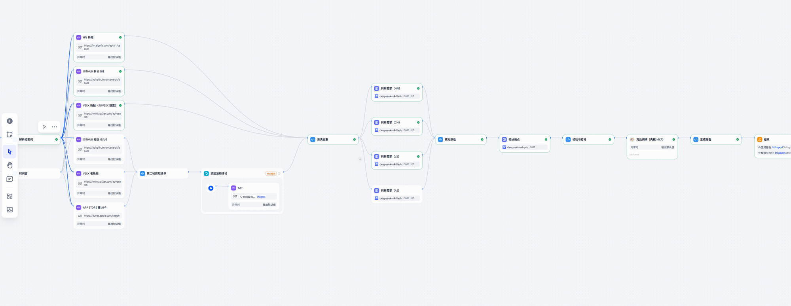
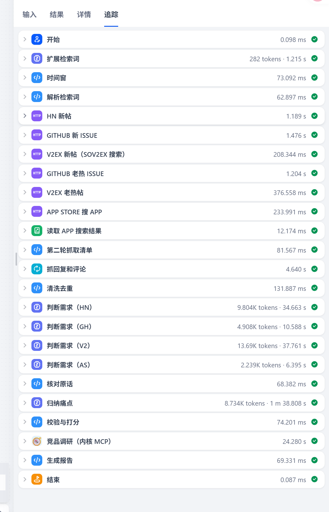
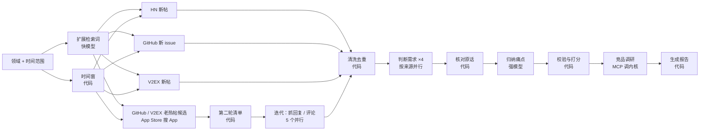

# 需求雷达（种子 2：Dify 工作流）

> 给独立开发者 / 做副业的人找需求：输入一个领域（如"记账"），从技术社区和 App Store 差评里抓**近期**的真实讨论，提炼"谁在为什么事受折磨、愿不愿意花钱"，给痛点排序，并调研头号痛点的现有竞品。
> **每条结论都附原帖链接。**

和求职 Agent（`../job-agent`）的关系：**一个内核，两个应用**。竞品调研不是在 Dify 里重做一遍，而是通过 MCP 调用求职 Agent 里那个"带来源核对的调研 Agent"。

---

**在线试用**：https://udify.app/workflow/yHnTLKMPzJuCRc2h （Dify 官方云；竞品调研经 MCP 调 `job.wyphub.com/mcp` 上的内核，带令牌鉴权。一次约 3 分钟）

## Dify 里的样子

| 工作流画布（26 个节点，含迭代节点并行抓回复/评论） | 一次运行的追踪（约 170 秒） |
|---|---|
|  |  |

`dist/demand_radar.yml` 可以直接导入你自己的 Dify（≥1.6，支持 MCP）复现。

---

## 一、跑出来是什么样（真实输出节选，领域"简历工具"）

> 抓取 70 条讨论（HN 30、GitHub 10、V2EX 30）→ 判定为需求 25 条（另有 0 条因引用原话对不上被丢弃）→ 归纳出 6 个痛点。
>
> | # | 痛点 | 谁在痛 | 痛度 | 提及 | 付费信号 | 总分 |
> |---|---|---|---|---|---|---|
> | 1 | 付费墙与导出限制 | 求职者/简历工具用户 | 5 | 5 | 4 | 5.0 |
> | 2 | 强制注册与数据隐私 | 关心个人数据的求职者 | 4 | 3 | 2 | 4.0 |
> | 3 | 排版美观耗时 | 想做美观简历的求职者 | 4 | 7 | 0 | 3.1 |
>
> 每个痛点下列出原帖证据：「原话」（[V2EX P61](https://www.v2ex.com/t/…)）……
>
> 最后一节"头号痛点的竞品情况"：Teal、Rezi、Jobscan、超级简历……的功能、定价、用户抱怨，每条附来源链接。

---

## 二、流程



| 步骤 | 节点类型 | 做什么 | 怎么防止出错 |
|---|---|---|---|
| 扩展检索词 | 模型（快） | 领域 → 英文关键词（HN、GitHub 用）+ 中文关键词（V2EX、App Store 用） | 解析失败就退回用原始领域词 |
| 时间窗 | 代码 | 新帖起点（默认近 12 个月，开始界面可改）、老帖"还活着"的门槛（近 6 个月有回复） | 不填或乱填都退回 12 个月 |
| 第一轮抓取 ×6 | HTTP（并行） | 三个来源的新帖各 24 条；GitHub / V2EX 老热帖候选；App Store 按领域词搜前 3 个 App | 任一来源挂了输出空结果、继续往下走 |
| 第二轮抓取 | 迭代节点（5 个并行） | 每个老热帖抓回复，每个 App 抓最新 50 条评论 | 同上 |
| 清洗去重 | 代码 | 老热帖**近期有回复才保留**（每来源最多 6 条，给模型看标题 + 最新 3 条回复，机器人回复不算）；App 评论只留 3 星及以下、每个 App 取 3 条写得最具体的（差评条条都是抱怨，实测不限量时占了一半以上的需求）；去 HTML、截断、去重、编号 | — |
| 判断需求 ×4 | 模型（快，按来源并行） | 每条帖子：是不是和领域相关的需求、摘一句原话、痛点类型、有没有付费信号 | 按来源拆批并行：一次判 90 条要 114 秒，拆开后约 25 秒 |
| 核对原话 | 代码 | **模型摘的"原话"必须真的出现在那条帖子里**，否则丢弃这条判断 | 防止模型替用户"编"抱怨 |
| 归纳痛点 | 模型（强） | 把说同一件事的需求归成 3～8 个痛点，评痛度 1～5 | — |
| 校验与打分 | 代码 | 证据编号必须是上一步核对过的需求；**提及次数、付费信号条数由程序数**（同一个 App 的差评最多算 2 条，免得某个 App 自己的毛病刷成头号痛点）；总分 = 痛度 40% + 提及 30% + 付费信号 30% | 不信模型报的数字，分数可复算 |
| 竞品调研 | 工具（MCP） | 头号痛点交给内核的 `research_competitors`：搜索（最多 6 次）→ 每条事实带来源 → 链接必须是本次搜索返回过的 | 服务不可用时输出默认文字，不让整个流程失败 |
| 生成报告 | 代码 | Markdown 报告，控制篇幅：排行最多 6 个痛点（带来源分布）、只展开前 3 名、每个最多 3 条证据（优先不同来源）、竞品只取总结 + 3 个空白点 + 3 条带链接的事实。约 2800 字，原来约 8500 字 | **链接、频次、分数都来自前面核对过的数据，模型不碰链接** |

设计原则和求职 Agent 一样：**模型负责理解和归纳，程序负责核对和计数**。

---

## 三、评测结果

脚本：`eval/run_eval.py`（在 `../job-agent` 目录下运行，复用它的模型适配和调研 Agent）。

**1. 需求判定：快模型 vs 强模型**（4 个领域 × 3 个来源，共 360 条真实帖子）

| 指标 | 结果 |
|---|---|
| 两个模型判断一致 | 252 / 360 = 70% |
| 不一致的 108 条 | 107 条是"强模型判需求、快模型没判"；其中 82 条来自 GitHub |
| 抽查 30 条不一致的帖子（人工裁决） | **快模型对 25 条**，强模型对 2 条，3 条两可 |
| 原因 | 强模型把任何功能请求都算需求，忽略了"和领域相关"——工作流用快模型，更准也更便宜 |

人工标注表：`eval/out/labels.csv`（360 条，含两个模型的判断，`human` 列留给人工填）。

**2. 竞品调研：两种做法**（4 个领域合计）

| 做法 | 链接 | 其中首页 | 具体页面 | 具体页面 404（地址根本不存在） | 平均耗时 | 平均成本 |
|---|---|---|---|---|---|---|
| A：Dify 里一个模型节点直接问 | 131 | 46 | 85 | **13**（如 `apps.apple.com/cn/app/id1234567890`） | 24 秒 | 1.7 分 |
| B：经 MCP 调内核调研 Agent | 41 | 3 | 38 | **0**（全部来自真实搜索结果） | 34 秒 | 24.7 分 |

结论：直接问模型又快又便宜，但会编链接（编 App Store 编号、想当然拼定价页）；内核贵约 15 倍，换来每个链接都可追溯。只调研**头号痛点**一次，是在可信和成本之间的折中。

**3. 端到端**（本机 Dify 1.18）：记账、笔记软件、简历工具都跑通，每次 140～170 秒；3 次运行共判定需求 86 条，因原话对不上被丢弃 0 条。

---

## 四、数据源

| 来源 | 接口 | 适合 | 实测 |
|---|---|---|---|
| Hacker News | Algolia 搜索 API（免费、无需 Key） | 英文、偏技术和产品 | 质量高 |
| V2EX | 官方 API **没有搜索**，用社区维护的 sov2ex 搜索；老帖回复用官方回复接口（每 IP 每小时 120 次） | 中文程序员、数码话题 | 质量高，中文需求的主力；每天约 900 个新主题，仍然活跃 |
| GitHub Issues | 官方搜索 API（未登录每分钟 10 次），只在标题里匹配；老 issue 评论用评论接口（未登录每小时 60 次） | **只适合开发者工具类话题** | 按点赞排序会搜出全站热门的无关 issue（"记账"搜出 Go 语言提案）；改成标题匹配后切题，但大众话题下多是学生项目的开发任务 |
| App Store（中国区） | iTunes 搜索 API + 官方用户评论 RSS（免费、无需 Key） | **普通用户**对现有 App 的抱怨 | 差评就是现成的痛点（"广告太多""手写识别差"）；最新 50 条评论多在近两周内；顺带拿到竞品名单和评分人数 |
| Reddit | — | — | 接不了：2026-10-16 起未登录的 JSON 接口不再响应（实测 403）；官方 API 要人工审批，且 2026-10-31 停止受理新申请、2027-03 关闭公共 API（新闻报道） |

**时效性**（2026-10-30 实测，"记账 / expense tracker"）：

| | 改之前（按热度/相关度） | 改之后 |
|---|---|---|
| 帖子年份 | V2EX 30 条几乎全是 2012～2020 年；HN 1/3 是 2023 年前 | 2025 年 10 条、2026 年 90 条 |
| 老热帖 | 混在一起，不区分死活 | 只要近 6 个月仍有回复的 |

"老热帖"实测：1 年前的高回复帖，近半年仍有人回复的——HN 8 个候选 0 个、V2EX 8 个候选 0 个（最后回复停在 2016～2022 年）、GitHub 有 2 个。所以 HN 不查老帖。

---

## 五、部署

**Dify 官方云**（线上演示用的就是这种）：「工具 → MCP」添加 `https://job.wyphub.com/mcp`（服务器标识 `job-kernel`，请求头 `Authorization: Bearer <令牌>`，超时 180 秒）→ 导入 `dist/demand_radar.yml` → 发布 → 打开 Web 应用。内核 MCP 的线上部署见 `../job-agent/deploy/`（`job-mcp.service`，Tunnel 里 `/mcp` 路径规则）。

**本机 Dify**：

1. 启动内核 MCP Server（在 `../job-agent`；`.env` 里要有 `MCP_TOKEN`）：
   ```powershell
   uv run job-mcp --host 0.0.0.0 --port 8002
   ```
2. Dify →「工具」→「MCP」→ 添加：
   | 项 | 填什么 |
   |---|---|
   | 服务器地址 | `http://host.docker.internal:8002/mcp` |
   | 服务器标识 | **`job-kernel`**（DSL 里按它引用，必须一致） |
   | 请求头 | `Authorization: Bearer <MCP_TOKEN>` |
   | 超时 | 180 秒（调研要 30～90 秒，默认 30 秒不够） |
3. 生成并导入 DSL：
   ```powershell
   uv run --no-project --with pyyaml python build_dsl.py
   ```
   Dify「工作室」→「导入 DSL 文件」→ 选 `dist/demand_radar.yml` → 发布。

踩过的坑：

| 现象 | 原因 / 处理 |
|---|---|
| MCP 工具调用成功，报告里竞品一节是空的 | Dify 把 MCP 工具的结构化返回放在节点的 `json` 输出里，`text` 是空的；报告节点两个都读 |
| 改了内核代码，Dify 调到的还是旧逻辑 | MCP Server 是独立进程，改完要重启 |
| 竞品调研突然什么都搜不到 | 智谱 `search_std` 某天对任何查询都返回"成功但为空"；内核搜索已加多引擎兜底 |

---

## 六、文件

| 文件 | 作用 |
|---|---|
| `code_nodes.py` | 7 个代码节点的源码。都是纯函数（Dify 沙箱只能用标准库），`build_dsl.py` 原样放进节点，本地可以直接单测 |
| `prompts.py` | 模型节点的提示词（评测脚本也 import 这里，保证评的就是线上那一版） |
| `build_dsl.py` | 生成 `dist/demand_radar.yml`（Dify 1.18 工作流 DSL，25 个节点，含一个迭代节点） |
| `tests/` | 代码节点单测，数据源用真实接口响应做夹具（`fixtures/recency/` 是 2026-10-30 按新参数抓的）：`uv run --no-project --with pytest --with pyyaml python -m pytest -q tests` |
| `eval/run_eval.py` | 评测（`classify` 需求判定、`compare` 竞品调研两种做法） |

---

## 七、已知局限

| 局限 | 想法 |
|---|---|
| 同一领域跑两次，头号痛点可能不同（"简历工具"一次是"付费墙"，一次是"重复撰写低效"） | 多次运行的痛点合并，按出现次数排序 |
| 一次约 2.5～3 分钟（归纳痛点用强模型约 90 秒） | 对比快模型归纳的质量，够用就换 |
| 每个来源只取 24 条新帖 | 加翻页；按热度二次排序 |
| App Store 只看中国区、前 3 个 App | 加美区（同一接口换国家代码）补英文普通用户 |
| GitHub 未登录评论接口每小时 60 次，一次运行最多用 6 次 | 频繁跑时在请求头加 GitHub Token |
| 需求判定只有模型互评 + 30 条抽查 | `labels.csv` 的 `human` 列等人工标注 |
