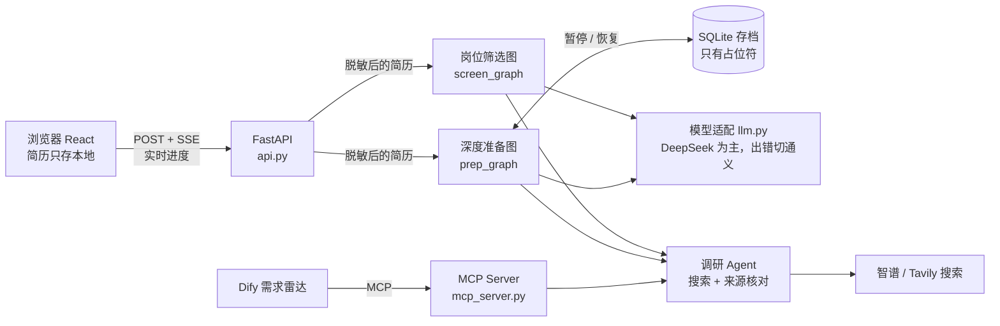
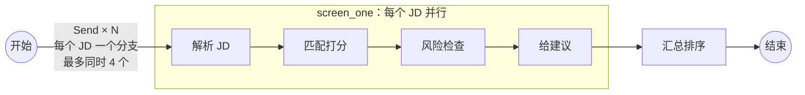
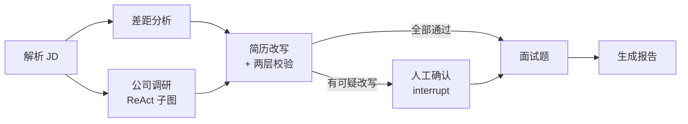
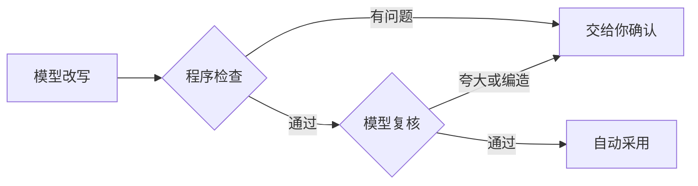

# 求职 Agent

> 给想转 AI 应用开发的程序员用的求职助手：**每天筛岗位，拿到面试后深度准备**。
> 线上地址：https://job.wyphub.com （LangGraph + LangChain + FastAPI + React）

核心承诺只有一条：**不替你编经历**。Agent 给出的每个结论都要指向原文（简历第几行、JD 哪句话、哪个搜索结果），由程序核对，核对不过的交给你确认。

---

## 目录

1. [能做什么](#一能做什么)
2. [整体架构](#二整体架构)
3. [流程详解：岗位筛选](#三流程详解岗位筛选)
4. [流程详解：深度准备](#四流程详解深度准备)
5. [防编造：三道关](#五防编造三道关)
6. [隐私、成本与可靠性](#六隐私成本与可靠性)
7. [评测结果](#七评测结果)
8. [本地运行](#八本地运行)
9. [代码结构](#九代码结构)
10. [接口](#十接口)
11. [已知局限与下一步](#十一已知局限与下一步)

---

## 一、能做什么

| 入口 | 什么时候用 | 你给它 | 它给你 |
|---|---|---|---|
| **岗位筛选** | 每天刷招聘 App 时 | 简历（上传一次，存在浏览器里）+ 1～10 个 JD（粘贴文字或上传截图） | 每个 JD 的匹配分（逐条列出哪条要求命中 / 部分 / 缺失，附简历原文依据）、风险标签（外包驻场、名不副实、加班、公司近期裁员欠薪……）、建议（直接投 / 改简历后投 / 放弃），按建议排序 |
| **深度准备** | 约到面试后 | 一个 JD | 差距分析、公司调研（每条事实附来源链接）、针对岗位的简历改写（每条可追溯原文，可疑的交你确认，可导出 Word）、9 道面试题（技术 / 项目深挖三层追问 / 公司）及结合你经历的答题要点 |

另外：内核的"调研 Agent"通过 **MCP** 开放给其他应用（见 [十、接口](#十接口)），种子 2「需求雷达」（`../demand-radar`，Dify 工作流）就用它做竞品调研。

---

## 二、整体架构



| 层 | 用了什么 | 为什么 |
|---|---|---|
| 编排 | **LangGraph**（StateGraph、Send、interrupt、checkpointer） | 需要并行（多个 JD、多个分析步骤）、需要中途停下来等人确认、需要断点续跑 |
| Agent | **LangChain 1.x** `create_agent` + 中间件 | 公司调研是"搜索 → 读 → 再搜"的循环，用现成的 ReAct Agent，中间件限制最多搜 6 次 |
| 模型 | DeepSeek（flash 快、v4-pro 强），通义 qwen3.7-plus 兜底，qwen3-vl-plus 看截图 | 6 个模型实测对比后选的，见 [七、评测结果](#七评测结果) |
| 后端 | FastAPI + SSE | 一次筛选几十秒，用 SSE 把"第 3 个 JD 正在查风险"实时推给浏览器 |
| 前端 | React + Vite + TypeScript | 三个页面：我的简历 / 岗位筛选 / 深度准备 |
| 部署 | VPS + systemd + Cloudflare Tunnel | 不开放任何端口，HTTPS 由 Cloudflare 负责，见 `deploy/README.md` |

几个概念（第一次接触的话）：

| 概念 | 一句话 |
|---|---|
| StateGraph | 把流程画成"节点 + 连线"，所有节点共享一份状态（一个字典） |
| Send | 条件边一次返回多个 `Send("节点", 子输入)`，有几个就开几个并行分支（map-reduce） |
| interrupt | 节点中途暂停，把问题交给人；人回答后用 `Command(resume=答案)` 接着跑 |
| checkpointer | 每一步存档；有了它才能暂停、恢复、断线重连 |
| SSE | 服务器推送事件：一个不关闭的 HTTP 响应，有进度就写一段 `event: … data: …` |
| MCP | AI 应用调用外部工具的标准协议，工具写一次，各种客户端都能用 |

---

## 三、流程详解：岗位筛选



| 步骤 | 做什么 | 怎么防止出错 |
|---|---|---|
| 解析 JD | 抽出岗位、公司、薪资、年限、硬性要求、技术关键词 | 用工线索（外包、加班）必须一字不差出自 JD 原文，否则丢弃 |
| 匹配打分 | JD 每条要求编号 R1、R2……，模型逐条判 命中 / 部分 / 缺失，并照抄简历原文作依据 | 程序检查：有没有漏判、重判；依据是否真的出自简历（按片段覆盖率核对，容忍 PDF 断行）。**分数由程序算**（命中 1、部分 0.5），不让模型打分 |
| 风险检查 | JD 里的外包驻场 / 加班 / 名不副实 / 前后矛盾 / 歧视性条件；公司近两年裁员欠薪 | JD 风险的依据必须是 JD 原文片段；"公司未公开"是规则判断；公司负面信息的链接必须是本次搜索返回过的；按公司名缓存 7 天、所有用户共享 |
| 给建议 | 直接投 / 改简历后投 / 放弃 | **程序规则**：≥75% 直接投，≥50% 改简历后投；有"外包驻场""名不副实"降一档。可解释、稳定 |

- 筛选量大，全部用快模型（实测与强模型分数差 ≤7 个百分点，耗时一半）。
- 一个 JD 失败不影响其他 JD；进度通过 `get_stream_writer()` 发自定义事件。
- 实测：17 个 JD 并行约 54 秒，逐个跑约 200 秒。

---

## 四、流程详解：深度准备



| 节点 | 做什么 | 要点 |
|---|---|---|
| 差距分析 | 同筛选的匹配打分，用强模型 | 依据必须出自简历 |
| 公司调研 | Agent 自己决定搜什么、搜几次（最多 6 次），按 业务 / 规模融资 / 技术与 AI / 近期动态 / 风险信号 / 面试经验 归类 | 每条事实带来源链接，**链接必须在本次搜索结果里**，否则整条丢弃；搜索词只有公司名和岗位名，不含简历内容 |
| 简历改写 | 只改与 JD 相关、表述不够贴合的条目（≤6 条），只能换说法 | 见 [五、防编造](#五防编造三道关) |
| 人工确认 | 有可疑改写时暂停，网页上逐条给出：原文 / 改写 / 问题 / 依据原文，你选 采纳 / 我来改 / 拒绝 | 默认拒绝（宁可不改也不留编造）；暂停期间关掉网页也没关系，存档在服务器（只有占位符） |
| 面试题 | 4 道技术 + 3 道项目深挖（每道 3 层追问）+ 2 道公司相关 | 答题要点引用的简历原文同样核对；没做过的经验提示"如实说明没做过" |
| 报告 | Markdown 报告 + 结构化的改写和面试题 | 网页上每条改写、每道题都能 👍👎；改写可导出 Word（改过的地方标黄） |

差距分析和公司调研互不依赖，从同一个节点分出两条边并行；`add_edge(["gap", "research"], "rewrite")` 等两个都完成再改写。

---

## 五、防编造：三道关



**第一关：程序检查**（确定性，可单测；`job/rewrite.py` 的 `rule_check`）

| 检查 | 例子 |
|---|---|
| 数字必须在原文里 | 日均 120 万笔 → 500 万笔 |
| 英文技术名必须在原文里（有同义词表：大模型 = LLM） | 加上 Kafka、Kubernetes |
| 中文技术 / 能力词表 | 后端 → 后端**微服务**；了解 LangGraph → **多智能体**编排 |
| 角色拔高词 | 参与 → **主导**、**带领**、**精通** |
| 去掉岗位限定词 | 参与**前端**开发 → 参与 AI 应用开发 |
| 新增表述：改写里连续 ≥4 个中文字，按"二字词"在原文任何位置都找不到 | ……，**并检查生成代码的安全** |
| 跨条目拼接（原文这条没有、简历别处有） | 给出提示，让你判断 |

**第二关：模型复核**（强模型，逐短语核对：通过 / 夸大 / 编造）——抓程序抓不到的语义问题，如"某模块"写成"整个系统"。

**第三关：人工确认**（interrupt）——前两关任一报问题，就停下来交给你。

为什么要三关：模型复核对"一句真话后面悄悄加一小段"不敏感（真实评测漏 18%），这类问题被逐一变成了程序规则。过程见 [七、评测结果](#七评测结果)。

同样的"让模型给出处、由程序核对"也用在：差距分析的简历依据、面试题的答题依据、风险的 JD 原文、调研事实的来源链接。

---

## 六、隐私、成本与可靠性

| 方面 | 做法 |
|---|---|
| 简历不出浏览器（除了处理那一刻） | 简历存在你浏览器的 localStorage；每次请求带上，服务器**先脱敏**（姓名、手机、邮箱、身份证 → `[NAME_1]` 等占位符）再交给模型；结果返回时在服务器内存里还原。存档、日志、执行轨迹里只有占位符（上线后实测存档中真实姓名、手机、邮箱出现 0 次） |
| 暂停后恢复 | 浏览器再发一次同一份简历，重新脱敏得到同样的占位符映射，所以能还原；你在网页上手改的文字也先脱敏再存 |
| 反馈 | 只记"哪类第几条、赞还是踩"，不存任何文字 |
| 费用 | 设置里可以填自己的 DeepSeek Key（只存在你浏览器里）；不填就用服务器的，每个 IP 每天 20 个 JD、全站每天 200 个 JD（最坏情况约 6 元/天） |
| 来源 IP | 线上经 Cloudflare Tunnel，真实 IP 从 `CF-Connecting-IP` 取，且只信来自本机 Tunnel 的请求 |
| 输入限制 | 简历 2 万字、JD 1 万字、文件 5MB；深度准备存档 7 天后自动删除 |
| 模型兜底 | DeepSeek 出错自动切 qwen3.7-plus（只给服务器 Key 兜底，你自带 Key 时不切） |
| 搜索兜底 | 智谱搜索引擎返回空结果就换下一个（实测某天 `search_std` 对任何查询都返回"成功但为空"）；没搜到东西不缓存 |
| 出错可查 | 流式任务出错既推给前端，也写服务器日志 |

---

## 七、评测结果

所有评测脚本在 `evals/`，说明见 `evals/README.md`。数据：17 个真实的 AI 应用岗位 JD、作者本人的简历 + 2 份虚构简历（前端转 AI、Python 后端 RAG）。

**防编造**（最重要的指标；逐条人工判断所有"自动通过"的改写）：

| 轮 | 改了什么 | 漏网（编造/夸大且自动通过） | 需人工确认的比例 |
|---|---|---|---|
| 1 | 原样 | 9 / 50 = 18% | 52% |
| 2 | 复核提示词逐短语核对 | 4 / 43 = 9% | 65% |
| 3 | 加"新增表述"检测 + 中文词表 | 2 / 32 = 6% | 81% |
| 4 | 加"去掉限定词"检测（全新一轮） | **0 / 41** | 83% |

另有 32 条人工构造样本（20 条编造、12 条诚实）：程序检查单独拦 18 条，加模型复核拦 20 条（漏检 0），误报 2 条。

**多模型对比**（7 个有标注的 JD + 24 条防编造样本；成本按官网价，单位人民币分 / 每个 JD）：

| 模型 | 筛选质量 | 筛选耗时 / 成本 | 防编造复核 漏检·误报 | 用在哪 |
|---|---|---|---|---|
| deepseek-flash | 召回 100%，风险 90%/100% | 10s / 2.9 分 | 0 · 0 | **筛选** |
| deepseek-v4-pro | 风险 100%/100% | 20s / 10.3 分 | 0 · 0 | **深度准备** |
| qwen3.7-plus | 风险 100%/100% | 36s / 2.9 分 | 0 · 0 | **出错兜底** |
| qwen-plus | 风险 78%/78% | 72s / 1.1 分 | 0 · 1 | — |
| Claude Haiku 5.5 | 风险 100%/89% | 35s / 3.5 分 | 0 · 3 | — |
| Claude Sonnet 5.5 | 召回 100% | 28s / 42.6 分 | 0 · 0 | 太贵 |

**其他**：

| 评测 | 结果 |
|---|---|
| JD 解析（17 个，8 个人工标注） | 硬性要求召回 96%～100%，关键词 F1 约 90% |
| 差距分析引用核对 | 196 条简历依据，修正核对规则后误报 0 |
| 风险标签（7 个有标注的 JD） | 召回 100%，精确率 90%～100% |
| JD 截图识别 | 人工整理的文本中 96% 的内容被识别出 |
| Word 导出 | 真实流程 6 条改写全部定位成功（5 条跨 PDF 断行） |
| 测试 | 51 个（48 离线 + 3 真实调用模型） |

---

## 八、本地运行

需要：Python 3.12 + [uv](https://docs.astral.sh/uv/)、Node.js 20+。命令在 PowerShell 里、本目录下运行。

```powershell
uv sync
cd web; npm install; npm run build; cd ..
uv run uvicorn job_agent.api:app --port 8001
```

浏览器打开 http://localhost:8001 。前端开发时另开终端在 `web/` 跑 `npm run dev`（5173 端口，`/api` 自动转到 8001）。

`.env`（放在本目录，不提交）：

| 变量 | 用途 | 必需 |
|---|---|---|
| `DEEPSEEK_API_KEY` | 主力模型 | 是 |
| `ZHIPUAI_API_KEY` | 搜索（智谱 Web Search） | 是（或用 Tavily） |
| `DASHSCOPE_API_KEY` | 截图识别、出错兜底（通义） | 建议 |
| `TAVILY_API_KEY` | 搜索换成 Tavily | 否 |
| `OPENROUTER_API_KEY` | 多模型对比评测（Claude） | 否 |
| `LANGFUSE_PUBLIC_KEY` / `LANGFUSE_SECRET_KEY` / `LANGFUSE_HOST` | 执行轨迹 | 否 |
| `MCP_TOKEN` | 内核 MCP Server 的访问令牌 | 用 MCP 时 |
| `JOB_FREE_PER_DAY` / `JOB_FREE_TOTAL_PER_DAY` | 免费额度（默认 20 / 200） | 否 |
| `JOB_FAST_MODEL` / `JOB_STRONG_MODEL` / `JOB_FALLBACK_MODEL` | 换模型，格式 `厂商:模型名` | 否 |

其他入口：

| 做什么 | 命令 |
|---|---|
| 命令行版深度准备 | `uv run job-prep --resume 简历.pdf --jd JD.txt`（中断后加 `--thread 编号` 接着跑） |
| 启动内核 MCP Server | `uv run job-mcp --host 0.0.0.0 --port 8002` |
| 离线测试 | `uv run pytest -q -k "not live"` |
| 全部测试（会真实调用模型，花几分钱） | `uv run pytest -q` |
| 部署到 VPS | `.\deploy\push.ps1`（见 `deploy/README.md`） |

---

## 九、代码结构

```
job-agent/
├─ src/job_agent/
│  ├─ core/                 与业务无关的基础设施
│  │  ├─ llm.py             模型适配：快/强两档、用户自带 Key（ContextVar）、出错兜底
│  │  ├─ pii.py             脱敏：正则替换成占位符，可还原
│  │  ├─ search.py          搜索适配：智谱（多引擎兜底）/ Tavily
│  │  └─ tracing.py         Langfuse 开关
│  ├─ job/                  求职业务
│  │  ├─ schemas.py         JD、简历的数据结构（字段说明就是给模型的抽取规则）
│  │  ├─ parse.py           解析 JD / 简历；引用核对（check_quotes）
│  │  ├─ ocr.py             JD 截图 → 文字
│  │  ├─ gap.py             差距分析
│  │  ├─ risk.py            风险标签 + 投递建议
│  │  ├─ research.py        调研骨架（run_research）+ 公司调研
│  │  ├─ rewrite.py         改写 + 程序检查 + 模型复核
│  │  ├─ interview.py       面试题
│  │  ├─ export.py          改写套回简历、导出 Word
│  │  ├─ screen_graph.py    岗位筛选图
│  │  └─ prep_graph.py      深度准备图
│  ├─ radar/competitor.py   竞品调研（给需求雷达用）
│  ├─ api.py                FastAPI + SSE
│  ├─ feedback.py           反馈计数
│  ├─ mcp_server.py         内核 MCP Server
│  └─ cli.py                命令行
├─ web/src/                 React：App、ResumePanel、ScreenPanel、PrepPanel、Thumbs、api.ts
├─ tests/                   51 个测试（模型调用全部可替换成假的）
├─ evals/                   评测集与评测脚本
├─ deploy/                  部署 / 下线脚本
└─ 笔记-第N周.md            每周的设计思路、踩坑、教训
```

想看"原理"建议按这个顺序读：`core/llm.py` → `job/parse.py`（行号 + 引用核对）→ `job/gap.py` → `job/rewrite.py`（三道关）→ `job/prep_graph.py`（LangGraph 主图）→ `job/screen_graph.py`（Send 并行）→ `api.py`（SSE + 暂停恢复）。

---

## 十、接口

**网页后端**（`api.py`）：

| 接口 | 作用 | 返回 |
|---|---|---|
| `POST /api/resume/text` | 上传简历文件 → 文字（不保存） | `{text}` |
| `POST /api/jd/ocr` | 1～5 张 JD 截图 → 文字 | `{text}` |
| `POST /api/screen` | 岗位筛选 | SSE：`progress` × N → `result {ranked, session}` |
| `POST /api/prep` | 深度准备 | SSE：`thread` → `node` × N → `review`（暂停）或 `report` |
| `POST /api/prep/{thread}/resume` | 提交人工确认，继续 | 同上 |
| `POST /api/export/resume` | 改写套回简历，下载 Word | docx |
| `POST /api/feedback` / `GET /api/stats` | 👍👎 / 汇总 | — |

请求头 `X-DeepSeek-Key` 可选：带了就用你的 Key、不占免费额度。

**内核 MCP Server**（`mcp_server.py`，Streamable HTTP，路径 `/mcp`，需 `Authorization: Bearer <MCP_TOKEN>`）：

| 工具 | 作用 |
|---|---|
| `research_company(company, job_title)` | 公司调研（求职视角），返回 `{markdown, report}` |
| `research_competitors(topic)` | 竞品调研（产品、定价、用户抱怨、没被满足的地方），返回 `{markdown, report}` |

---

## 十一、已知局限与下一步

| 局限 | 想法 |
|---|---|
| 83% 的改写需要人工确认 | 让改写更保守：少改、只改真正提升匹配度的 |
| 防编造的"0 漏网"是在同一批简历和 JD 上测的 | 换一批新 JD、新简历再验证 |
| 模型复核会放过"具备 AI 应用开发实战经验"这类有依据的总结句 | 目前判为可接受；如果用户反馈不喜欢，再加规则 |
| 截图识别偶尔认错字（"字蒙"→"宇蒙"），公司名错了会搜错公司 | 识别结果可编辑；以后高亮公司名提醒核对 |
| 免费额度记在内存里，重启清零 | 有滥用再加设备指纹或简单登录 |
| Langfuse 执行轨迹只验证了"连不上不影响业务" | 有 Key 后看真实轨迹 |

下一步（规划第 5～6 周）：模拟面试（多轮对话 + 评分）、面试复盘记忆（跨会话）、投递进度看板；社区发帖拉第一批用户。
